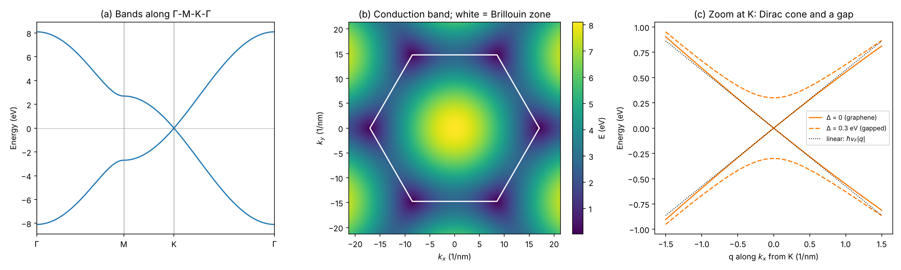

Graphene Tight-Binding Model

If an electron sits in Graphene, what energies can it have and how does it vary with momentum? The tight-binding model calculates this exact relationship, revealing a gapless band structure where electrons behave like massless particles near the Dirac points.

## How the model works (my understanding)

Graphene is a honeycomb lattice of carbon atoms. Each atom contributes one $p_z$ electron that can move through the sheet. In the tight-binding picture an electron sits on an atom but can hop to its three nearest neighbours. The hopping energy $t$ ($\approx 2.7$ eV, a fitted value) measures how easily it does so. Everything below follows from this one idea plus the lattice geometry.

**From a lattice to a 2×2 matrix.** The unit cell contains two atoms (A and B). Bloch's theorem lets me replace the infinite crystal with a 2×2 Hamiltonian at each wavevector $\mathbf{k}$. Its off-diagonal element is $-t\,f(\mathbf{k})$, where

$$f(\mathbf{k}) = \sum_{j=1}^{3} e^{\,i\mathbf{k}\cdot\boldsymbol{\delta}_j}$$

adds up the phase an electron picks up when hopping to each of the three neighbours.

The eigenvalues of $H(\mathbf{k})$ are the allowed energies $E(\mathbf{k})$. Diagonalising at many $\mathbf{k}$-points gives two bands: valence and conduction. Because $\mathbf{k}$ is two-dimensional, I plot the bands along a path through the high-symmetry points of the Brillouin zone, $\Gamma \to M \to K \to \Gamma$, and also map the conduction band over the whole zone to check that the path does not miss anything.

At the zone corner K the three phase factors are 120° apart and cancel, so $f(K)=0$ and the two bands touch (the Dirac point). Near K the dispersion is linear,

$$E = \pm\hbar v_F |\mathbf{q}|, \qquad \hbar v_F = \tfrac{3}{2}\,t\,d,$$

which describes massless carriers moving at a constant speed $v_F$, independent of energy. This is why Graphene is special.

If the two sublattices are made inequivalent (on-site energies $+\Delta$ and $-\Delta$, as if A and B were different atoms), the symmetry that forced the touching is gone. The energies become

$$E = \pm\sqrt{\Delta^2 + (\hbar v_F q)^2},$$

a gap of $2\Delta$ opens at K, and near the band edge the carriers behave like ordinary massive particles with $m^* = \Delta / v_F^2$. This is how a gapped 2D semiconductor can arise from a Dirac material (for example, in hexagonal boron nitride(hBN), where the two sites are different atoms).

## Results

*Figure: (a) bands along k path; (b) conduction band over the Brillouin zone(white) (c) zoom at K,  Dirac cone Vs a gapped case 

**Checks against analytic values** ($t = 2.7$ eV, $a = 0.246$ nm):

| Parameter | Analytical | Code |
|---|---|---|
| $E(\Gamma)$ | $\pm 3t = \pm 8.10$ eV | $\pm 8.100$ eV |
| $E(M)$ | $\pm t = \pm 2.70$ eV | $\pm 2.700$ eV |
| $E(K)$ | $0$ | $0$ |
| Fermi velocity | $3td/2\hbar = 8.74\times10^5$ m/s (Real graphene is in the $10^6$ range)| $8.72\times10^5$ m/s |

The Fermi velocity is about $c/343$. The small difference comes from measuring the slope at a finite distance from K (the code agrees to four digits when that distance is made small).

**What the figure says**

- **(a) Bands along the path.** The valence and conduction bands are mirror images of each other. They are furthest apart at $\Gamma$ (total width $6t = 16.2$ eV), flatten at M (a saddle point, where the density of states peaks), and touch linearly at K.
- **(b) Whole zone.** The conduction band is highest at $\Gamma$ and reaches zero only at the six zone corners (K and K′). A grid scan finds no other touching points. The smallest gap it reports (0.03 eV) is only because no grid point lands exactly on K.
- **(c) Zoom at K.** For $\Delta = 0$ the bands form a straight-line cone with slope $\hbar v_F \approx 0.575$ eV·nm. Away from K the true band departs from the straight line, and unequally on the two sides of K (trigonal warping), so the cone is only an approximation near K. For $\Delta = 0.3$ eV a gap of $2\Delta = 0.6$ eV opens and the band edge becomes parabolic, with $m^* \approx 0.07\,m_e$.

**To summarize.** A two-parameter model (hopping $t$ and lattice geometry) reproduces graphene's Dirac cone and Fermi velocity, and one extra parameter ($\Delta$) shows how a gap and an effective mass emerge when the sublattice symmetry is broken.

## Limitations

- Nearest-neighbour hopping only. This makes the valence and conduction bands exact mirror images, which real graphene is not (next-nearest-neighbour hopping $t'$ will break this).
- $t = 2.7$ eV is a fitted input, not derived here, so the numbers are results of the model, not predictions for real graphene.
- No spin, spin-orbit coupling, electron-electron interactions.

## Possible extensions

- Add next-nearest-neighbour hopping $t'$.
- Compute the density of states.
- Compare with a DFT band structure.

## Acknowledgements and references

I wrote this code myself, using Claude's reference implementation (Claude) for guidance on structure and for the sanity checks.

- A. H. Castro Neto et al., "The electronic properties of graphene", *Rev. Mod. Phys.* **81**, 109 (2009).
